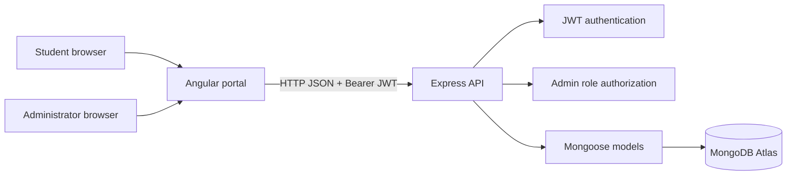

# Design and Implementation of a Web-Based Hostel Accommodation and Management System for Tertiary Institutions

> **Draft status:** Technical first draft based on the inspected source tree. This is not a final institutional submission. Replace every `[STUDENT TO COMPLETE]` / `[VERIFY]` marker with institution-approved, personally verified information. Chapter Four deliberately has no claimed passing results or fabricated screenshots.

## Preliminary pages

- **Institution:** [STUDENT TO COMPLETE]
- **Department / programme:** [STUDENT TO COMPLETE]
- **Student name / registration number:** [STUDENT TO COMPLETE]
- **Supervisor:** [STUDENT TO COMPLETE]
- **Submission date:** [STUDENT TO COMPLETE]
- **Formatting template, citation style, and required declaration pages:** [OBTAIN FROM DEPARTMENT]

## Abstract

Manual hostel accommodation processes can make it difficult for tertiary institutions and students to keep a consistent record of applications, decisions, and room assignments. This project designs and implements a web-based hostel accommodation and management system that supports student registration and authentication, hostel and room records, accommodation applications, administrative review, and room-and-bed allocation. The implementation uses an Angular and TypeScript single-page frontend, an Express and Node.js API, MongoDB accessed through Mongoose, and JSON Web Tokens for authentication. The API defines student and administrator roles and protects administrative operations with authorization middleware. Student application and allocation views are scoped to the authenticated account in the existing API. The system is intended to make these records easier to submit, review, and retrieve through a responsive browser interface. Evaluation results, screenshots, participant or institutional context, and measured outcomes must be added only after the student runs and documents the approved tests. **[STUDENT TO VERIFY the final features, deployment environment, evaluation method, and abstract word limit.]**

**Keywords:** hostel management, accommodation allocation, Angular, Express, MongoDB, JWT.

# Chapter One — Introduction

## 1.1 Background of the study

Tertiary institutions must coordinate accommodation capacity, student requests, and room assignments. A digital application can provide structured records for these steps and give authorized users a common view of their status. This project develops a browser-based system around the existing institution-project API and its records for users, hostels, rooms, applications, and allocations. **[STUDENT TO ADD institution-specific background, approved evidence, and relevant local references.]**

## 1.2 Statement of the problem

Where accommodation requests and room assignments are managed through disconnected or paper-based processes, students may find it difficult to submit and follow requests, while administrators may find it difficult to maintain current room and bed information. This project addresses those process needs with authenticated student and administrator workflows. **[STUDENT TO CONFIRM the actual current process and document observed problems; do not present these general statements as measured findings.]**

## 1.3 Aim

To design and implement a web-based hostel accommodation and management system for tertiary institutions.

## 1.4 Objectives

1. Provide student account registration and authenticated sign-in.
2. Present available hostel and room information retrieved from the API.
3. Allow authenticated students to submit and review their own accommodation applications.
4. Allow administrators to manage hostel and room records and review applications.
5. Allow administrators to assign an approved application to a room and bed.
6. Provide authenticated views of application status and the student's current allocation.
7. Evaluate the core workflows using documented functional and authorization tests.

## 1.5 Scope

The inspected implementation includes registration, login, current-user lookup, role-bearing JWTs, hostel and room CRUD endpoints, student application submission/history/cancellation, administrator application review, student allocation lookup, and administrator allocation management. The Angular frontend implements views and forms against those existing APIs. Profile is read-only because no profile-update endpoint exists in the inspected backend. Notifications are excluded from this project version. **[STUDENT TO CONFIRM institutional boundaries, intended deployment, and any approved scope exclusions.]**

## 1.6 Significance

The intended users are students and accommodation administrators. Students can use a single portal for supported accommodation requests and allocation details. Administrators can use authenticated management workflows to keep supported hostel, room, review, and allocation records in the system. These are intended benefits; effectiveness must be established by evaluation rather than asserted as a measured result.

## 1.7 Limitations

The current API has no profile-edit endpoint or notification service. It has limited request validation and pagination. Some database-dependent requests can fail when MongoDB Atlas cannot be reached. The frontend stores a JWT in browser local storage, which is appropriate only for a controlled academic demonstration and carries a cross-site scripting exposure if the application has an XSS flaw. API operations involving several database writes are not implemented as transactions. **[STUDENT TO ADD limitations observed during the final test/deployment.]**

## 1.8 Definition of terms

- **Hostel:** an accommodation facility represented by a hostel record.
- **Room:** a capacity-limited room associated with a hostel.
- **Application:** a student's request for accommodation for an academic session.
- **Allocation:** an administrator's assignment of an approved application to a room and bed.
- **JWT:** a signed token used by the API to identify an authenticated caller and role.

# Chapter Two — Literature Review and Related Systems

## 2.1 Conceptual review

Discuss the concepts of web-based information systems, accommodation inventory, application processing, role-based authorization, and room allocation. Support definitions and claims with sources personally read and citations approved by the department.

## 2.2 Review of related systems

Compare at least three genuine systems or published studies relevant to tertiary accommodation, student portals, or room-allocation software. For each, describe the source, context, features, strengths, and limitations based on the cited source. **[STUDENT TO RESEARCH AND COMPLETE; no systems or findings are fabricated in this draft.]**

| System / study | Verified source and context | Relevant features | Limitation / difference |
|---|---|---|---|
| [STUDENT TO COMPLETE] | [VERIFIED CITATION] | [FROM SOURCE] | [FROM SOURCE] |
| [STUDENT TO COMPLETE] | [VERIFIED CITATION] | [FROM SOURCE] | [FROM SOURCE] |
| [STUDENT TO COMPLETE] | [VERIFIED CITATION] | [FROM SOURCE] | [FROM SOURCE] |

## 2.3 Comparative discussion and research gap

Use the verified comparison above to explain which operational needs are addressed by this project and how its implementation differs. Avoid claiming a research gap until the literature has been reviewed and cited.

## 2.4 Chapter summary

[STUDENT TO COMPLETE after literature review.] 

# Chapter Three — Methodology and System Design

## 3.1 Development methodology

The software is being developed iteratively: inspect the existing API and schemas, add the Angular client without deleting the React client, integrate authentication and workflows, then build and exercise the application. **[STUDENT TO STATE the methodology required by the department and describe actual project iterations, dates, and evidence.]**

## 3.2 Functional requirements

- The system shall authenticate users using the existing login API and route users according to the returned role.
- A student shall view active hostels and supported room details.
- A student shall submit an application with a hostel, academic session, preferred room type, and optional reason.
- A student shall retrieve and cancel their own pending applications through protected API routes.
- A student shall view their active allocation when one exists.
- An administrator shall list/create/update supported hostel and room records.
- An administrator shall list and review pending applications as approved or rejected.
- An administrator shall allocate an approved application to a valid available room bed and list/cancel allocations.
- The interface shall display loading, empty, success, and API error states.

## 3.3 Non-functional requirements

The interface should be responsive, use accessible labels and clear status feedback, and avoid exposing administrative controls to student navigation. Server-side middleware, rather than interface visibility, is the security boundary for admin operations. Performance, accessibility, backup, and availability objectives require institution-specific targets and testing. **[STUDENT TO SPECIFY measurable targets and security assumptions.]**

## 3.4 Architecture

The browser-based Angular application uses Angular Router, standalone components, Reactive Forms, and HttpClient. An Angular HTTP interceptor attaches the Bearer token. Requests are sent to the Express REST API at the configured API base URL. Express mounts route modules under `/api`; authentication middleware verifies JWTs, and admin middleware checks the role for privileged endpoints. Mongoose models represent users, hostels, rooms, applications, and allocations in MongoDB Atlas.

**[STUDENT TO REPLACE/VERIFY this architecture against the final deployed configuration.]**

## 3.5 Use cases

| Actor | Use case | API operation |
|---|---|---|
| Student | Register / sign in | `POST /api/auth/register`, `POST /api/auth/login` |
| Student | View account | `GET /api/auth/me` |
| Student | Browse hostels / rooms | `GET /api/hostels`, `GET /api/hostels/:id`, `GET /api/rooms`, `GET /api/rooms/hostel/:hostelId` |
| Student | Submit and follow applications | `POST /api/applications`, `GET /api/applications/my`, `PUT /api/applications/:id/cancel` |
| Student | View own allocation | `GET /api/allocations/my` |
| Administrator | Manage hostels and rooms | Admin-protected hostel and room CRUD routes |
| Administrator | Review applications | `GET /api/applications`, `PUT /api/applications/:id/review` |
| Administrator | Manage allocations | `GET /api/allocations`, `POST /api/allocations`, `PUT /api/allocations/:id/cancel` |

## 3.6 Database design

Collections and fields below are derived from the inspected Mongoose schemas; document exact indexes and relationships in the institution's required notation.

| Entity | Main fields / constraints |
|---|---|
| User | `fullName`, unique lower-case `email`, hashed `password`, `role` (`student`/`admin`), optional unique sparse `matricNumber`, contact and academic fields, `isActive` |
| Hostel | unique `name`, `description`, `location`, `gender`, room counters, `status`, `isActive` |
| Room | hostel reference, room number, floor, capacity, occupied spaces, status, active flag; unique hostel + room number |
| Application | student and hostel references, preferred room type, session, reason, status, admin comment and review metadata; unique student + hostel + session |
| Allocation | unique student and application references, hostel and room references, bed number, academic session, status and allocator; active room + bed uniqueness |

The model enum values are: user role `student/admin`; user level `ND1/ND2/HND1/HND2`; gender `male/female`; hostel/room status `available/full/maintenance`; room preference `single/double/triple/quadruple`; application status `pending/approved/rejected/cancelled`; allocation status `active/cancelled`. **[STUDENT TO generate a formal ER diagram from the final verified models.]**

## 3.7 Validation and security design

Angular forms provide client-side input checks for usability. The backend remains authoritative. Protected endpoints require `Authorization: Bearer <JWT>`; admin routes also require admin role middleware. Students' application and allocation detail queries enforce ownership in the controller. **[STUDENT TO record final security checks. Note the public admin-creation route was found during audit and has been changed to require admin authentication; include this only after verifying the final route and retesting.]**

## 3.8 Implementation tools

Verified source dependencies include Angular 21, TypeScript, Angular Router, Angular Forms, Angular HttpClient, Tailwind CSS v4, Node.js, Express, Mongoose, MongoDB Atlas, JSON Web Tokens, and bcryptjs. **[STUDENT TO add exact version output and development-machine details from the final environment.]**

# Chapter Four — Implementation, Testing, and Results

## 4.1 Implementation

Describe the final Angular login/registration pages, protected route structure, student dashboard, hostel list/detail, application form/history, read-only profile, room allocation view, and administrator management workflow. Add annotated screenshots captured from the running, final application. Screenshots must show real responses or clearly labelled empty states, not fabricated values.

### Screenshot evidence to capture

1. Login form at desktop and mobile widths.
2. Invalid-credentials feedback.
3. Student dashboard with the student's live application/allocation data, or honest empty states.
4. Hostel list and a real hostel detail page.
5. Application form and persisted submission/history.
6. Student allocation details after a real admin assignment.
7. Admin application review and room/bed allocation screens.
8. Unauthorized admin access response/navigation.

**[STUDENT TO insert screenshots, date, browser size, and captions after capturing them.]**

## 4.2 Test plan and actual results

No test outcome should be marked Pass until it has been run against the final environment and evidence retained. The production Angular build has been run successfully during development; that is a build check, not proof that MongoDB-dependent user workflows pass. At the time of drafting, Atlas queries from the application returned connectivity errors, so data workflows need a successful retest.

| ID | Test | Expected result | Actual result / evidence |
|---|---|---|---|
| T01 | Angular production build | Build completes without TypeScript/template errors | `[Record latest run and build output]` |
| T02 | Backend startup and Atlas connection | Backend starts and database can serve a query | `[RETEST; observed Atlas DNS/TLS connectivity error during development check]` |
| T03 | Valid student login | Login returns JWT/user and opens student dashboard | `[NOT YET VERIFIED with a supplied real account]` |
| T04 | Invalid login | API validation message appears; no dashboard access | `[A deliberately invalid login returned HTTP 401 and the Angular page displayed the API message]` |
| T05 | Logout and protected route | Session clears; protected route returns to login | `[RETEST against final build]` |
| T06 | Student hostel/application workflow | Real hostels load and submitted application persists | `[BLOCKED pending stable Atlas access and a real test account]` |
| T07 | Admin authorization/review | Student is denied; admin can review a pending application | `[RETEST with student and admin accounts]` |
| T08 | Allocation workflow | Approved application can be assigned to available bed | `[RETEST with real records; beware schema uniqueness limitation]` |
| T09 | Invalid/expired token | Token cleared; user redirected to login | `[RETEST on final build]` |

## 4.3 Results and discussion

[STUDENT TO complete only after executing the test table. Include measured observations, failures, retests, and limitations. Do not infer successful database workflows from a successful frontend build.]

# Chapter Five — Summary, Conclusion, and Recommendations

## 5.1 Summary

This project implements a role-based web application for hostel accommodation workflows using an Angular frontend and an existing Express/Mongoose API. The implementation covers account authentication, hostel and room records, student applications, administrative review, and room/bed allocation, subject to successful verification against the live database.

## 5.2 Conclusion

[STUDENT TO finalize after integration tests. State which objectives were achieved and cite the evidence in Chapter Four; do not claim untested workflows as completed.] 

## 5.3 Recommendations

Potential future work, subject to institutional approval, includes secure cookie-based session storage and CSRF protections, stronger backend request validation, paginated search, transaction-safe allocation/counter updates, consistent capacity reporting, audit logs, notifications, automated backups, and a secure initial administrator provisioning procedure. Prioritize fixes based on actual evaluation and institutional requirements.

# References

**Do not submit this empty section.** Add only sources personally retrieved, read, and cited in the text, in the institution's required style. Verify author names, title, year, publisher/journal, volume/pages, DOI or stable URL, and access date for web sources. No academic citation has been invented in this draft.

1. [STUDENT TO ADD a verified source on information systems / software development methodology.]
2. [STUDENT TO ADD a verified source on tertiary student accommodation or hostel management.]
3. [STUDENT TO ADD a verified source on web application security / authentication.]
4. [STUDENT TO ADD official framework documentation only if cited and the department accepts technical documentation as a reference.]

# Appendices

- **Appendix A:** Final questionnaire/interview instrument, if actually used and ethically approved.
- **Appendix B:** API route summary and selected source-code excerpts.
- **Appendix C:** Test execution evidence and dated screenshots.
- **Appendix D:** User guide and PowerShell setup/run instructions.
- **Appendix E:** Supervisor/institution approval documents, if required.
